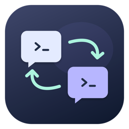
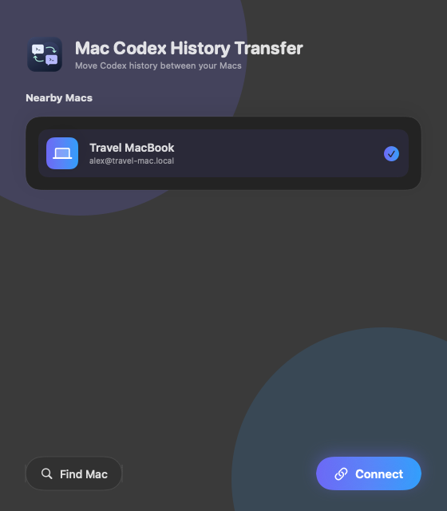
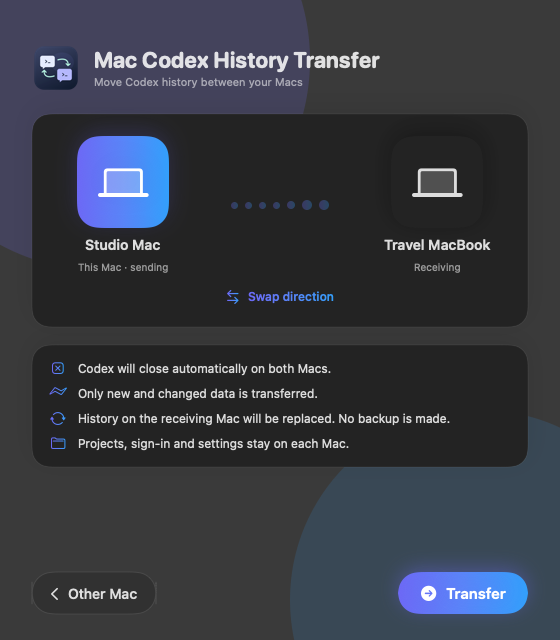

<div align="center">
  
  <h1>Mac Codex History Transfer</h1>
  <p>Take your local Codex conversations from one Mac to another.</p>
  <p>
    <a href="https://github.com/HooMDooM/mac-codex-history-transfer/actions/workflows/ci.yml"></a>
    
    
    <a href="LICENSE"></a>
  </p>
  <p><a href="https://github.com/HooMDooM/mac-codex-history-transfer/releases/latest"><strong>Download for macOS</strong></a> · <a href="#getting-started">Getting started</a> · <a href="#build-from-source">Build from source</a></p>
</div>

A small native macOS app for moving local Codex history between your own computers. Find your other Mac, connect once, choose a direction and transfer. Afterward, the receiving Mac can use its local copy independently.

This is an independent community project, not affiliated with or endorsed by OpenAI.

<p align="center">
  
  
</p>

<p align="center"><sub>App previews with fictional device and account names.</sub></p>

## At a glance

| Feature | What it does |
| --- | --- |
| Nearby discovery | Finds Macs running the app on your local network using Bonjour. |
| Guided connection | Confirms the other Mac’s fingerprint and configures a dedicated SSH key. |
| Direct transfer | Streams history over SSH without uploading it to a cloud storage service. |
| Incremental updates | Compares file manifests and block hashes to send changed data. |
| Progress on both Macs | Shows the transfer stage and percentage on each computer. |
| Two languages | Uses Russian for Russian macOS preferences and English otherwise. |

> **Transfer replaces the destination history; it does not merge conversations. Version 0.4.0 does not keep a backup after success.** Make your own backup before the first transfer, especially if both Macs have different histories. Project folders and worktrees are not transferred.

## Getting started

1. Download the ZIP from [Releases](https://github.com/HooMDooM/mac-codex-history-transfer/releases/latest), extract it and open the app on both Macs.
2. Keep both computers awake on the same local network and allow **Local Network** access when macOS asks.
3. Enable **Remote Login** in **System Settings → General → Sharing** for your user account on the Mac you are connecting to. The app can open these settings.
4. Click **Find Mac**, select your other computer and click **Connect**.
5. On the first connection, compare the displayed fingerprint with the code in the app on the other Mac. Confirm only if they match, then enter that Mac’s user password. The password is not saved.
6. Finish active Codex tasks, choose the transfer direction and click **Transfer**. Codex closes on both Macs before the transfer starts.
7. Wait for completion, then open Codex on the receiving Mac. You can now turn off the other Mac.

To initiate transfers from either computer, complete pairing once from each Mac. No Terminal commands are needed for the pairing flow.

### Requirements

- macOS 13 or later; Apple silicon or Intel.
- Python 3 on both Macs, available through Apple Command Line Tools.
- The same Codex version and the same absolute home directory path on both Macs, such as `/Users/alex`.
- Default Codex storage at `~/.codex`; custom `CODEX_HOME` and `sqlite_home` locations are not supported.
- SSH access between the Macs and enough free space on the receiving Mac to stage the history.
- Project folders available at their original paths if you want to resume work on those projects.

Release builds are ad-hoc signed and **not notarized by Apple**. macOS may require **Open Anyway** in Privacy & Security settings.

## What moves

| Transferred | Kept on each Mac |
| --- | --- |
| Active and archived session history | Account credentials and sign-in state |
| History and session indexes | Local configuration |
| Memories and sidebar state | Plugins and installed tools |
| Supported state, thread history, goals and memory databases | Project folders and Git worktrees |

The source history is authoritative. Conversations that exist only on the receiving Mac are removed from its active history when the transfer completes.

## How it works

1. Checks both installations and acquires an operation lock on each Mac.
2. Closes Codex and checks for processes still using its files.
3. Compares history manifests and block hashes.
4. Streams changed data over SSH into a staging directory on the receiver.
5. Verifies checksums and SQLite integrity before replacing selected history files.
6. Removes temporary transfer data after successful completion.

Handled installation errors trigger rollback. A power loss or forced termination during replacement may require manual recovery; this is not a filesystem-wide atomic operation. The app operates on Codex’s local storage format, so future Codex changes may require updates.

## Privacy and connection details

- Transfers go directly between your Macs over SSH.
- Bonjour advertises the computer and account names to the local network, not chat contents or passwords.
- The password entered during pairing is not saved.
- A dedicated key is stored at `~/Library/Application Support/Codex Transfer/keys/id_ed25519`.
- Its public key is installed in the other Mac’s `~/.ssh/authorized_keys` with a `CodexTransfer` label. The key permits commands as that user; it is not restricted to history transfer. Forwarding and PTY features are restricted.
- To revoke access, remove the matching entry from the receiving Mac’s `authorized_keys`. Preserve unrelated entries.
- Changed SSH host keys are not accepted automatically.

## Troubleshooting

| Problem | What to check |
| --- | --- |
| The other Mac does not appear | Open the app on both Macs, allow Local Network access and check that the Wi-Fi network does not isolate clients. |
| Connection refused | Enable Remote Login on the other Mac and allow your user account. |
| Pairing fails | Verify the user password and that Python 3 is available on the other Mac. |
| Versions or home paths differ | Match the Codex versions and absolute home paths before transferring. |
| Files are still in use | Finish active tasks and close other Codex clients or tools using `.codex`. |
| A transfer was interrupted | Stop remaining transfer processes on both Macs, inspect the operation journal and recover before retrying. |

Operation data is stored under `~/Library/Application Support/Codex Transfer/operations/`. If `journal.json` has status `prepared`, previous history files may remain in `~/.codex-transfer-old-<operation>` and staged files in `~/.codex-transfer-incoming-<operation>`. Keep Codex closed and preserve these directories while recovering. Do not discard the operation lock until you have confirmed no transfer process remains.

## Build from source

```sh
git clone https://github.com/HooMDooM/mac-codex-history-transfer.git
cd mac-codex-history-transfer
python3 build.py
```

The build uses Apple’s Swift compiler, AppKit, SwiftUI and Python’s standard library. It generates the icon, compiles `arm64` and `x86_64` binaries, combines them with `lipo`, signs the app ad-hoc and creates a ZIP in `dist/`.

## Tests

```sh
python3 -m unittest -v test_transfer test_pairing
swiftc Discovery.swift Localization.swift Tests/DiscoveryTests.swift -o /tmp/discovery-tests
/tmp/discovery-tests
```

Automated checks cover transfer staging, integrity checks, rollback, pairing, real key generation, localization coverage and discovery input validation. They use temporary fixtures and simulated pairing; they do not prove every two-Mac, network or Codex-version combination. See [CONTRIBUTING.md](CONTRIBUTING.md) for the optional Bonjour integration test.

## Source map

| File | Responsibility |
| --- | --- |
| `main.swift`, `Views.swift` | Application state and native interface |
| `Discovery.swift` | Bonjour announcement and discovery |
| `pairing.py` | SSH key setup and interactive pairing |
| `transfer.py` | Transfer orchestration and streaming |
| `agent.py` | Local history validation, staging and installation |
| `Localization.swift`, `localization.py`, `translations.json` | English and Russian interface strings |
| `Icon.swift`, `build.py` | Icon generation and universal app packaging |

## Contributing and license

Issues and focused pull requests are welcome. Please read [CONTRIBUTING.md](CONTRIBUTING.md) and avoid posting credentials or private chat data.

Released under the [MIT License](LICENSE).
